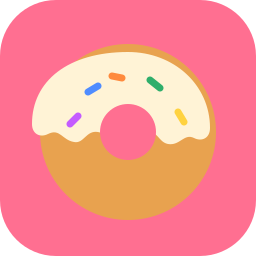

<p align="center"></p>

<h1 align="center">Glaze & Grind</h1>
<p align="center"><b>A donut & coffee shop tycoon for PC, Web and mobile — built in Godot 4.</b></p>

<p align="center">
  <a href="../../actions/workflows/ci.yml"></a>
  
  
  
</p>

Run a bustling donut shop through the morning rush. Your crew fries, glazes, brews and steams **on their own** — you're the manager deciding who works where, what to stock, which machines to buy, and when to jump in and pull a batch out of the fryer yourself. Build a five-star reputation, open new locations, and climb from **Trainee** to **CEO**.

> Inspired by Papa's Donuteria, Diner Dash and Two Point Hospital. An original brand — not affiliated with any real coffee or donut chain.

---

## Features

**Restaurant management**
- Customers queue, order at the register, wait at pickup and pay — with tips based on speed and quality
- Donuts are made the way real shops do it: **mix dough → fry a batch of 6 → glaze & top → display case**
- **Fryer minigame**: tap the fryer and stop the needle in the green zone for a *PERFECT* batch (or burn it)
- 8 made-to-order drinks: hot coffee, tea, espresso, latte, cappuccino, iced coffee, berry refresher, frozen coffee, plus flavour shots

**Autonomous crew (behaviour trees)**
- Every employee has Speed, Accuracy, Intelligence, Teamwork, Reliability, Stress, Happiness and XP
- They pick the most urgent task themselves, help busy coworkers, clean when idle and take breaks when stressed
- Personalities: Steady, Cheerful, Perfectionist, Speedy, Chatty
- Real mistakes: burned batches, spilled drinks, wrong orders, forgotten toppings, bad dough, late arrivals
- Level up to unlock espresso and blended drinks; set a **focus station** per employee

**Customers**
- Students, business workers, families, tourists, **influencers** (can go viral) and **food critics** (reviews count ×5)
- Patience, mood, loyalty, spending level and favourite items; regulars come back and spend more

**Tycoon layer**
- 13 tracked ingredients — run out and items vanish from the menu; rush deliveries cost 1.5×
- Upgrade 7 stations through 3–4 levels, plus a 2nd register, blender, comfy break room, Auto-Glazer, Smart Inventory and bigger display case
- Full ledger: sales, tips, ingredients, wages, rent, maintenance, repairs, fines
- **6 locations** (Main Street → Mall → Highway → Airport → City Center → Mega Flagship) with their own traffic, prices, rent and customer mix; stores you're not running earn passive income
- Career: Trainee → Shift Manager → Store Manager → District Manager → Regional Director → CEO

**Days & events**
- Morning rush, lunch rush, afternoon slowdown, evening rush, with dawn-to-night lighting and lamps
- Random events: Snow Day, Holiday Rush, School Opening, Championship Night, Equipment Breakdown, Power Outage, Health Inspection, Sick Day, Viral Post

**Everything else**
- Live dashboard with real-time graphs (revenue, profit, happiness, crew efficiency, rating, waste, revenue by hour)
- 3 save slots + autosave, versioned save schema with migration, optional cloud mirror / HTTP sync
- **JSON modding** — recipes, customers, stores, equipment, events ([guide](docs/MODDING.md))
- All sound and music is synthesised at runtime — no licensed assets
- Responsive layout from phones to ultrawide; mouse, touch, keyboard and gamepad

## Screenshots

Screenshots can be generated straight from the game (no editor needed):

```bash
xvfb-run -s "-screen 0 1280x720x24" godot --rendering-driver opengl3 --fixed-fps 60 \
  --resolution 1280x720 --path . -s tests/screenshots.gd
```

They're written to `docs/screenshots/` (main menu, morning rush, staff card, dashboard, fryer minigame, restock, evening, day summary, management tabs).

## Play it

**From source (any OS):**
1. Install [Godot 4.3+](https://godotengine.org/download) (standard, not .NET)
2. Clone this repo and open `project.godot` in Godot
3. Press **F5**

**Builds:** grab the latest from [Releases](../../releases), or from the artifacts of any [CI run](../../actions).

## Controls

| Action | Keyboard / Mouse | Touch | Gamepad |
|---|---|---|---|
| Select crew / customer / station | Left click | Tap | — |
| Pause / resume | Space or P | ⏸ button | Start |
| Speed 1× / 2× / 3× | 1 / 2 / 3 | buttons | RB = 3× |
| Pull the fryer batch | F | PULL button | X |
| Dashboard | D or Tab | Stats button | Back/Select |
| Quick save (slot 1) | F5 | — | — |
| Pause menu | Esc | ☰ button | Guide |

## How to play
1. **Shift:** customers arrive in waves. Watch the order tickets (top right) and the crew strip (bottom left). Tap a stressed employee to send them on a break, or give someone a focus station during a rush.
2. **Frying:** when a batch is in the oil, tap the Fryer and hit **PULL** in the green zone.
3. **Low stock?** Hit **Stock** for a rush delivery.
4. **After closing:** review the ledger, then restock, hire, upgrade, tweak par levels and expand.

## Build & export

Export presets are included for **Windows, Linux, Web, Android APK, Android AAB (Play Store), macOS and iOS**.

```bash
# one-time: install export templates from the Godot editor (Editor → Manage Export Templates)
godot --headless --path . --export-release "Linux"           builds/linux/GlazeAndGrind.x86_64
godot --headless --path . --export-release "Windows Desktop" builds/windows/GlazeAndGrind.exe
godot --headless --path . --export-release "Web"             builds/web/index.html
godot --headless --path . --export-release "Android"         builds/android/GlazeAndGrind.apk
```

- **Android:** set your Android SDK path and keystore in *Editor Settings → Export → Android*. For the Play Store, use the **Android AAB** preset (needs *Project → Install Android Build Template*) and a release keystore.
- **macOS / iOS:** export from a Mac; iOS needs Xcode and your Apple Team ID in the preset.

### CI/CD
Every push runs [`.github/workflows/ci.yml`](.github/workflows/ci.yml):
1. Unit tests (`tests/run_tests.gd`)
2. A headless 3-day gameplay simulation (`tests/smoke_sim.gd`)
3. Exports for Linux, Windows, Web and Android (debug-signed APK) uploaded as artifacts

Push a tag like `v0.1.0-alpha` and the builds are attached to a GitHub Release automatically.

## Run the tests

```bash
godot --headless --path . -s tests/run_tests.gd                   # unit tests
godot --headless --fixed-fps 60 --path . -s tests/smoke_sim.gd    # plays 3 days, prints the ledger
```

## Project structure

```
├── data/                  game content (JSON): recipes, ingredients, customers, equipment, stores, events
├── scenes/main.tscn       entry scene (everything else is built in code)
├── scripts/
│   ├── autoload/          Bus (signals), DB (data + mods), Game (profile), Saves, Sfx
│   ├── core/              pure simulation: ledger, inventory, orders, tasks, staff, behaviour trees, clock…
│   ├── world/             store layout, stations, employees, customers, FX
│   └── ui/                HUD, dashboard graphs, management, summary, menus, theme
├── tests/                 unit tests, gameplay simulation, screenshot capture
├── docs/                  Game Design Document, Technical Design, Modding guide, Roadmap
├── mods_example/          a sample mod (Pumpkin Season)
└── .github/workflows/     CI + exports + releases
```

Read the [Game Design Document](docs/GameDesignDocument.md) and [Technical Design](docs/TechnicalDesign.md) for the full breakdown.

## Roadmap
See [docs/Roadmap.md](docs/Roadmap.md) — next up: drive-thru, delivery orders, sprite art pass, Steam/Play achievements, leaderboards and co-op.

## License
[MIT](LICENSE) © 2026 Jaineil Rana
